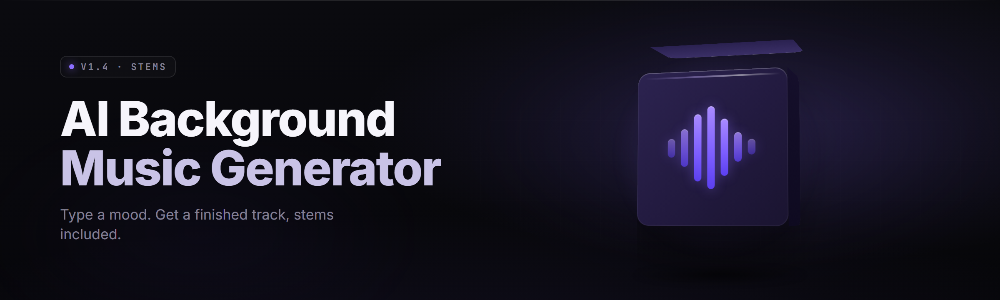

  
  
  

  

  
  

---

**The only AI background music generator that ships a full studio timeline, stems, and a real render queue — not a 30-second loop toy.**

## Table of Contents
- [System Requirements](#system-requirements)
- [What is ai-music-generator-studio](#what-is-ai-music-generator-studio)
- [The Problem](#the-problem)
- [The Solution](#the-solution)
- [Overview](#overview)
- [Quick Start](#quick-start)
- [Comparison](#comparison)
- [Grouped Module Catalog](#grouped-module-catalog)
  - [**Synthesis Engine**](#synthesis-engine)
  - [**Generative Models**](#generative-models)
  - [**Arrangement & Structure**](#arrangement--structure)
  - [**Mixing & Processing**](#mixing--processing)
  - [**Export & Delivery**](#export--delivery)
  - [**Studio & Workflow**](#studio--workflow)
- [Installation](#installation)
- [All Modules Status](#all-modules-status)
- [Compatibility / Platform Support](#compatibility--platform-support)
- [Usage Guidelines](#usage-guidelines)
- [Known Issues](#known-issues)
- [FAQ](#faq)
- [Troubleshooting Flow](#troubleshooting-flow)

---

## System Requirements

| Component | Minimum | Recommended |
|---|---|---|
| OS | Windows 10 21H2 x64 | Windows 11 23H2 x64 |
| CPU | 4-core / 2.6 GHz (AVX2) | 8-core / 3.8 GHz (AVX-512) |
| RAM | 8 GB | 16 GB |
| GPU | DirectX 11, 4 GB VRAM | DirectX 12, 8 GB VRAM (CUDA optional) |
| Storage | 2.5 GB free (SSD) | 6 GB free NVMe |
| Audio | Any WASAPI device | ASIO interface, 48 kHz |
| Runtime | .NET Desktop 6 | .NET Desktop 8 |
| Network | Offline capable | 25 Mbps (model updates) |

---

## What is ai-music-generator-studio

A Windows desktop **AI background music generator** — you describe a mood, a length, a reference track, and it renders a fully arranged, mixed, and mastered instrumental bed for video, games, streams, or podcasts. Not a clip. A finished cue with stems.

| Term | Explanation |
|---|---|
| Cue | One complete piece — intro, body, outro, timed to a length |
| Stem | An isolated track layer (drums, bass, pads, melody, FX) |
| Mood vector | A numeric embedding steering tonality, tempo feel, density |
| Reference match | Analyze an existing track and lock macro/key/tempo |
| Render queue | Background batch of cues rendering non-blockingly |
| Seed lock | Reproduce an identical output from a stored seed |
| Loop point | A sample-accurate bar boundary the file loops cleanly on |

- Renders cues from 15 seconds to 20 minutes with a full structure.
- Exports stems and a single mixed master at once.
- Reproducible: every output stores a seed you can reimport.
- Runs fully offline for core synthesis; models update on demand.

---

## The Problem

- Free loop packs are three-bar clips repeated until a video dies of boredom.
- Stock music sites lock real tracks behind per-download credits and license headaches.
- Generative "AI music" tools render 30-second blobs with no intro, no outro, no arc.
- Video editors can't stretch a loop to 6:40 without algorithmic seams you can hear.
- Game devs need loops that bow-tie sample-accurately at bar boundaries — almost nothing does.
- No stems mean you can't duck the bass under your voiceover without a wrecked master.
- Session musicians for spec work want an arrangement skeleton, not a finished printable.

---

## The Solution

| Problem | Solution in this tool |
|---|---|
| Boring repeated loops | Structure engine builds intro → body → break → outro arcs |
| Paywall/licensing | Offline generation, you own the output |
| 30-second blobs | Cue length slider 15s–20m with matching structure |
| Awkward stretching | Native bar-locked loops with sample-accurate loop points |
| No stems | One-click stem bounce per layer |
| Ducking hell | Stem output + built-in sidechain tool |
| Blank-page block | Reference-match + mood vector seeds an arrangement |

---

## Overview

| Category | Details |
|---|---|
| Distribution | .exe desktop app (portable build available) |
| Genre coverage | Cinematic, lo-fi, ambient, corporate, tension, fantasy, synthwave |
| Output formats | WAV 24/48, FLAC, MP3 320, stem WAV bundles |
| Session model | Editable project, non-destructive, seed-tracked |
| Offline core | Synthesis + arrangement fully local |
| Update model | In-app model downloader, checksum-verified |
| Footprint | ~1.9 GB base install + model packs |

Use it as a blank-page killer: throw a mood and a moodful reference at it, get a cue with a real shape, then ride the timeline to cut it exact. The studio keeps every render reproducible so you can hand a client the same track twice.

---

## Quick Start

1. 📝 **Describe the cue** — pick genre, mood, tempo range, and target length.
2. 🎚️ **Nudge the mood vector** — pull towards "warm," "tense," "spacious" until it sits right.
3. 🎬 **Preview on the timeline** — hear the arrangement arc before committing renders.
4. 📤 **Bounce** — export master + stems, or push to the render queue and walk away.
5. 🔒 **Save the seed** — lock the seed to reimport the exact cue later.

### Download

  

---

## Comparison

| Aspect | Loop Stores / Stock Sites | Clip-Only AI Generators | This Tool |
|---|---|---|---|
| Length range | Fixed files | 15–60 sec | 15 sec – 20 min |
| Structure | None | Flat | Intro/break/outro arcs |
| Stems | Sometimes | No | Yes, per layer |
| Licensing | Per-track, restricted | Varies | You own output |
| Loop locking | Manual editing | None | Sample-accurate bar lock |
| Reproducibility | N/A | Poor | Seeded, exact |
| Offline | Downloads | Cloud only | Core offline |
| Cost | Credits/subscription | Subscription | One app |

---

## Grouped Module Catalog

### 🎛️ **Synthesis Engine**

The engine is the sound source. It runs an oscillator topology and a sampled-instrument rack side by side under a single voice manager, so generative material and rendered textures mix without a glue seam. CPU-friendly by default; the heavy spectral pass is opt-in.

**Synthesis**
- Oscillator topology (wavetable, FM, additive, granular)
- Sampled rack loader (SFZ-ish, internal pack format)
- Adaptive voice manager with steal policy
- Spectral freeze/texture pass (opt-in, GPU-Accelerated)
- Analog drift/humanize saturation model

### 🧠 **Generative Models**

The model layer decides *what* content the engine plays. Different checkpoints specialize in different roles — a drum model, a harmony model, a melodic-dissonance model for tension cues. Model packs download on demand and are checksum-verified. Core models ship in the base install so first-run works offline.

**Generative Models**
- Base melodic/harmonic checkpoint (bundled)
- Percussion pattern model
- Ambient/texture pad model
- Cinematic tension model
- Lo-fi degradation model
- Model pack manager (download/verify/roll-back)
- Fine-tune slots for user-supplied reference sets

### 🎼 **Arrangement & Structure**

Arrangement is where most generators fall flat — they produce material with no arc. This layer owns the cue map: intro bars, body sections, a bridge or break, and an outro, all constrained by the target length. It respects tempo grid and key center throughout so transitions don't stumble.

**Arrangement & Structure**
- Energetic arc curve editor (drag a line, edits don't just describe it)
- Automatic intro/break/outro generator
- Tempo-grid & key-center lock per section
- Loop-point snapping to bar boundaries
- Reference-match analyzer (macro, key, tempo feel)
- Variation B/C passes (theme restatement)
- Length targeting with tight tolerance

### 🔊 **Mixing & Processing**

A cue is only as good as its bus. The mixing layer carries a channel-strip chain per layer with a master bus chain downstream, then a light mastering stage. Everything is inspectable and bypassable — nothing hidden under "auto-master" mystery boxes.

**Mixing & Processing**
- Per-layer channel strip (EQ, comp, saturation)
- Master bus chain + metering
- Sidechain/ducking tool (voiceover-ready)
- Loudness match helper (integrated LUFS targeting)
- Stereo field & width shaping
- Reverb/space model driven by the mood vector

### 📦 **Export & Delivery**

Delivery owns all the file output paths — a single master, a multifile stem bundle, or files handed to another piece of software (editors, game engines). Batch export supports the render queue so you can ship a whole pack while you go make coffee.

**Export & Delivery**
- WAV 24/48, FLAC, MP3 320 export
- Multi-stem bundle export
- Video-editor handoff profile (marker-laden reference WAV for editing)
- Game-engine loop manifest (bpm, bars, loop points)
- Batch export via render queue
- Checksum sidecar for delivery verification

### 🖥️ **Studio & Workflow**

Studio is the daily driver — everything you touch when there isn't a nice clean way to abstract it away. Undo depth, project model, seed tracking, render queue, preset browser, hotkeys. It stays out of the way when you want it to and gets out of it when you need throughput.

**Studio & Workflow**
- Non-destructive project model
- Seed tracking + reimport
- Undo depth (200+ steps)
- Render queue (background batch)
- Preset & mood-vector browser
- Prompt-to-mood vector translation
- Hotkey layer (DAW-style)
- Light/dark/cue-sheet themes
- Crash-recovery session autosave

**Total active modules: 29**

---

## Installation

1. **Download the archive.** Go to the project page and grab the current build archive. Extract anywhere you like — `C:\Tools\AI-Music-Studio` is fine but no path is special-cased.
2. **Run the `.exe`.** Launch the executable from the extracted folder. First run unpacks core models (~1.2 GB) into local appdata; subsequent runs start in under two seconds.
3. **Verify the sound path.** Open **Preferences → Audio** and pick your output device. If you're on ASIO, choose the driver; WASAPI shared works out of the box. Hit **Test Tone** and you're done — the first cue render is only a prompt away.

---

## All Modules Status

| Module | Status | Description |
|---|---|---|
| Base melodic checkpoint | ✅ Working | Bundled model, offline first-run |
| Wavetable oscillator | ✅ Working | Core tone source |
| FM oscillator | ✅ Working | Harmonic complexity pass |
| Granular engine | ✅ Working | Texture/freeze material |
| Percussion model | ✅ Working | Drum/pattern generation |
| Ambience pad model | ✅ Working | Sustained background layers |
| Tension model | ✅ Working | Cinematic/dramatic cues |
| Lo-fi model | ✅ Working | Degraded, VHS-style beds |
| Model pack manager | ✅ Working | Download/verify/roll-back |
| Fine-tune slots | 🟡 Beta | User reference set training |
| Reference-match analyzer | ✅ Working | Macro/key/tempo extraction |
| Arc curve editor | ✅ Working | Drag-to-edit cue energy |
| Structure generator | ✅ Working | Intro/break/outro arcs |
| Tempo/key lock | ✅ Working | Per-section constraints |
| Loop-point snapping | ✅ Working | Bar-aligned loop ends |
| Channel strip | ✅ Working | Per-layer EQ/comp/sat |
| Master bus | ✅ Working | Metering + master chain |
| Sidechain/ducking | ✅ Working | Voiceover ducking |
| Loudness helper | ✅ Working | LUFS targeting |
| Stereo shaping | ✅ Working | Width/field control |
| Reverb model | ✅ Working | Mood-driven space |
| WAV/FLAC/MP3 export | ✅ Working | Master export path |
| Multi-stem export | ✅ Working | Layer bounce |
| Editor handoff profile | ✅ Working | Marker-laden reference |
| Engine loop manifest | ✅ Working | BPM/bars/loop points |
| Batch/queue export | ✅ Working | Render queue path |
| Project model + seeds | ✅ Working | Reproducible sessions |
| Preset browser | ✅ Working | Mood/genre presets |
| Crash recovery | ✅ Working | Autosave on autopilot |

---

## Compatibility / Platform Support

| Platform / Host | Status | Notes |
|---|---|---|
| Windows 11 x64 | ✅ Full | Primary target |
| Windows 10 x64 | ✅ Full | 21H2+ required |
| Windows on ARM | 🟡 Experimental | x64 emulation path |
| Linux (WINE) | 🟡 Experimental | Audio device quirks |
| macOS | ❌ Not supported | No build in 2026 |
| ASIO interface | ✅ Full | Lowest latency route |
| WASAPI shared | ✅ Full | Default fallback |
| Video editors (handoff WAV) | ✅ Full | Marker import |
| Game engines (loop manifest) | ✅ Full | Sidecar describes loop |

---

## Usage Guidelines

| Allowed | Not allowed |
|---|---|
| Generate cues for your own video, games, streams | Redistribute the app itself as a paid product |
| Monetize content that uses rendered cues | Reuse model packs in a competing trainer without license |
| Modify presets, seeds, and project files freely | Ship altered binaries as "official" builds |
| Use stems in your own mixes and masters | Strip seed metadata to pass work off as another engine's |
| Personal/educational and commercial projects | Claim the tool generates copyrighted samples you don't own |

---

## Known Issues

| Issue | Solution |
|---|---|
| First-run model unpack slow on HDD | Move install to SSD, or let the initial unpack finish once |
| ASIO device not appearing | Install vendor driver, rescan in Preferences → Audio |
| Export dialog locked during render | Render queue runs in background — dismiss dialog, edits continue |
| Loop not sample-accurate in some editors | Snap loops to the exported bar markers, not editor auto-detect |
| Model download fails on slow network | Retry from the pack manager; partial files are cleaned automatically |
| High CPU during GPU spectral pass | Disable GPU spectral in Preferences → Performance on older cards |

---

## FAQ

**1. Is ai-music-generator-studio an AI background music generator or an editor?** Both. It's an AI generator engine as the source of material, with a lightweight studio and mixer around it so you can shape that material into a finished cue without a second app.

**2. Can it work fully offline on day one?** Yes for the core. Base checkpoints ship in the installer, so synthesis, arrangement, and export all work without a network. Model packs and updates need a connection, but nothing renders through the cloud.

**3. Do I get stems?** Yes. Every render can bounce all layers at once — drums, bass, pads, melody, FX — alongside a mixed master WAV.

**4. What cue lengths does it handle?** From 15 seconds up to 20 minutes in one project. Loop points snap to the bar grid so even long cues stay clean on repeat.

**5. Can I reproduce exactly the same cue later?** Every project stores its seed. Reimport a seed and a model version and you get the exact same render within floating-point tolerance.

**6. Does it match an existing track's key and tempo?** Yes. Drop a reference into the analyzer and it extracts macro-feel, key center, and tempo range to seed the arrangement. It doesn't sample the source file — no audio is derived from the reference itself.

**7. Does it just repeat one bar until the target time?** No. The structure layer produces intro, body, a break or bridge, and an outro, budgeted against the cue's target length.

**8. Will it sound like every other AI generator?** The engine is where it stops feeling generic: varied oscillator topologies, model-specific checkpoints per role, and a mixing layer that emits real stems with width and space shaping.

**9. What are the hardware requirements?** See the [System Requirements](#system-requirements) table above — a 6-core box and 16 GB is the comfortable place for long cues, but short ones render cleanly on the minimum spec.

**10. Is model training on custom references supported now?** Fine-tune slots are in beta. The pack manager lets you roll back to a previous fine-tune without touching bundled models.

---

## Troubleshooting Flow

Render sounds broken/silent → Test the audio path (Preferences → Audio → Test Tone) → If silent, switch output device and re-test → If tone plays, check the project's master mute/bypass → If still broken, reset audio settings via Preferences → Reset → If the issue persists, inspect the per-layer channel strips for a bypassed/muted strip → Last resort, open a crash-recovery project or fall back to the previous seed's cached preview.

Repeated crashes on render → Disable GPU spectral in Preferences → Performance → Retry → If it recovers, the driver was the trigger; update your GPU driver and re-enable → If not, disable the sample-based rack pass to isolate model vs. rack.

---

That closes the tour of **ai-music-generator-studio 2026** — an AI background music generator that tries to earn the word *studio* rather than attach it. Kick off the download, drop in a mood, and let the render queue do the boring part.

  

